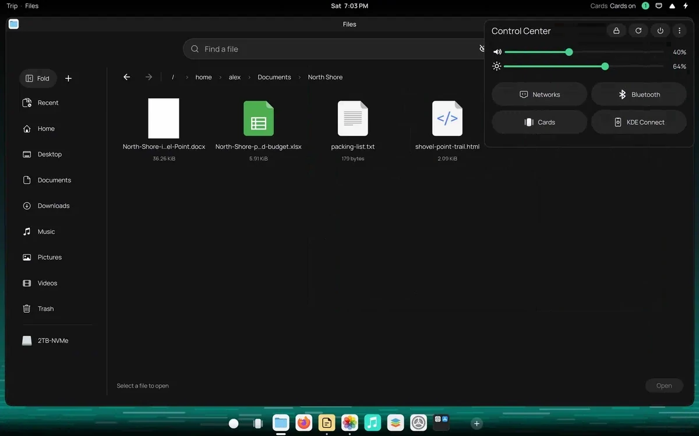

<p align="center">
  <picture>
    <source media="(prefers-color-scheme: dark)" srcset="assets/readme/banner-dark.png">
    
  </picture>
</p>

<p align="center">
  
  
  
  
</p>

<p align="center">
  <a href="#install">Install</a> · <a href="#controls">Controls</a> · <a href="docs/README.md">Docs</a> · <a href="https://shuffleplasma.com">Part of Shuffle</a>
</p>

<p align="center">
Kadunce turns your windows into cards you can flip through, pair and arrange by
touch, mouse or keyboard. Your apps stay ordinary Plasma windows, and switching
Kadunce off puts everything back.
</p>

<p align="center"></p>
<p align="center"><sub>Spread</sub></p>

## What you get

<table>
  <tr>
    <td width="33%" valign="top"><b>Cards</b><br>Every application window is a card. Opening an application adds one; the cards you already have stay as they are.</td>
    <td width="33%" valign="top"><b>Spread</b><br>Your cards in one ordered row. Choose one to make it the Active card, the card you are using.</td>
    <td width="33%" valign="top"><b>Stacks</b><br>Related cards kept together, which you move through one at a time, round and round from the card you opened.</td>
  </tr>
  <tr>
    <td width="33%" valign="top"><b>Bento</b><br>Several cards side by side in one layout. In Spread each pane is its own card, and choosing one brings back the same layout.</td>
    <td width="33%" valign="top"><b>Table</b><br>Your workspaces as tabs along the top, each with its cards hanging below. Go to one, or carry a card to another.</td>
    <td width="33%" valign="top"><b>Auto layout</b><br>On a big display, cards lay themselves out side by side. Snap one to an edge to place it, and the rest fill in around it.</td>
  </tr>
</table>

## Controls

| Task | Touch | Keyboard |
| --- | --- | --- |
| Spread | Swipe up from the bottom edge | `Meta+S` |
| Active card | Tap a card in Spread | `Enter` in Spread |
| Bento | Drag a window to the left or right edge | `Meta+B` |
| Table | Pull down from the top edge | `Meta+W` |
| Plasma desktop | Switch Cards off in the tray | `Meta+Esc` |

Kadunce's keys work only while it runs. Every other gesture, tap and key is in
[docs/INPUT.md](docs/INPUT.md).

If anything goes wrong, `Meta+Esc` puts every window back on the ordinary Plasma
desktop, and the **Cards** switch in the system tray turns Kadunce off
entirely.

## Install

```bash
./install.sh
```

The installer checks and builds Kadunce, then asks for permission to install the
KWin plugin. Log out and back in afterwards so KWin loads it. Kadunce runs on
your distribution's own KWin.

<details>
<summary>Requirements</summary>

- KDE Plasma 6.7 or newer
- A Wayland session
- Qt 6.10 and KDE Frameworks 6.26, or newer
- KWin development files
- CMake and a C++20 compiler
- `pkexec` for system installation

</details>

<details>
<summary>After a KWin update</summary>

Run `./install.sh` again after every KWin update, or choose **Repair for
current KWin…** in the Cards menu. Cards you switched off stay off through it.
When Kadunce takes a touch drag from KWin, it leaves KWin nothing that loses
the next one.

</details>

<details>
<summary>Turn off or uninstall</summary>

```bash
./disable.sh
./uninstall.sh
```

`disable.sh` returns every window to Plasma and turns Kadunce off until you turn
it on again. The **Cards** switch stays in the system tray, so you can always
turn Kadunce off completely. `uninstall.sh` removes what was installed, the repair
kit and Kadunce's state among it, keeps your settings in `kaduncerc` for a later
install, and leaves this folder as it is; log out and back in if the plugin is
still loaded in the current session.

</details>

## Displays

Every window is a card, on every display. A small display shows one card at a
time, or a Bento pair. A big display lays its cards side by side, and a card you
pick joins what is already open.

Each display has its own Spread, with its own cards: a card belongs to the
display it stands on, and its display's context line names it. Carry or send a
card to another display and it goes with its Stack, to be shown there. The
primary display, the one you choose, else your touchscreen, else the largest,
takes the cards of a display you unplug.

### Auto layout on a big display

Drag a window to the upper half of a side edge and it takes a full-height
column on that side. The lower half puts it under whatever is already on that
side. With one card open, the next window you open pairs with it. New windows
fill the open room, or join the shortest column, or start a new one, whichever
keeps every window larger. Once the screen is full, Kadunce lays everything out
evenly and keeps your snapped card on its side; only when even that cannot fit
does the window used longest ago step back into Spread. Drag a divider to
fine-tune.

### Prefer your own layout?

Auto layout not your thing? Keep a display as ordinary windows (below), draw
zones for it with `Meta+T`, and switch to them with `Meta+Shift+B`.

<details>
<summary>More about displays</summary>

- A window you carry to another display belongs to that display from then on.
- Unplug the display holding Spread and its cards move to the next one; plug it
  back in and they return. Unplug another display and its cards stay in Spread.
- Search floats on any display, and joins Spread once Spread is open.
- Wherever a touchscreen drives a display, Kadunce answers its top and bottom
  edges itself, so the swipe up to Spread and the pull down to Table work on any
  touchscreen.
- You can keep other displays as ordinary windows instead, with
  `kaduncerc` `[Spread] OtherDisplays=windows`. There an edge snap organizes
  every window into one Bento layout, or into your zones.

</details>

<details>
<summary>More about cards, Bento and Table</summary>

- A Bento pane's card in Spread sits beside its partners in the layout's order
  until you move it. A window that leaves a layout becomes its own card. Each
  display has one Bento layout at a time.
- Each workspace in Table keeps its own cards and Bento layouts, and one left
  empty goes away unless you named it.

</details>

## The Cards menu

The **Cards** icon in the system tray is Kadunce's switch; clicking it turns
Kadunce on or off.

<details>
<summary>What the menu holds</summary>

- **Cards on**, the same switch.
- Which KWin Kadunce was built for, and **Repair for current KWin…**, which
  rebuilds it after a KWin update.
- **Monitors use my zones (Meta+T)**, which switches a display kept as ordinary
  windows between filling itself and the zones you drew, as `Meta+Shift+B` does.
- **Settings…**, where you set the gutter around the Active card, 4 to 48 px,
  10 px by default. Once set, Bento's panes stand that far apart too.

Every word the menu shows can be translated.

</details>

## For developers

<details>
<summary>Folders and checks</summary>

Read `AGENTS.md` before working in this repository. The documentation index is in `docs/README.md`.

```text
native/                 KWin effect, window controllers, and native tests
control/                system tray control
tests/                  source, package, control, and session checks
docs/                   product contracts and architecture
install.sh              verified installation
disable.sh              safe release and temporary disable
uninstall.sh            installed component removal
```

Run the repository checks before proposing a change:

```bash
./verify.sh
```

It runs the documentation, source, package and control checks; `install.sh` runs
the source, package and control checks itself before it builds.
`bash tests/verify-headless.sh` runs the native domain tests that do not link
KWin, needing only a C++20 compiler and Qt6Core, as a fast pre-check where the
Plasma development stack is unavailable.

Changes to the compositor also need the private route matrix, a fresh login
session and physical testing. `docs/TESTING.md` describes every check and what it
proves.

</details>

## Part of Shuffle

Kadunce is one of the open-source pieces of Shuffle, a touch-first desktop for
KDE Plasma, alongside [Tettegouche](https://github.com/carlsonjm/tettegouche),
[Temperance](https://github.com/carlsonjm/temperance),
[Gooseberry](https://github.com/carlsonjm/gooseberry) and
[Split Rock](https://github.com/carlsonjm/split-rock). In Shuffle, Kadunce is
called Cards. Get the whole thing at [shuffleplasma.com](https://shuffleplasma.com).

## License

Kadunce is licensed under GPL-2.0-or-later. See `LICENSE`.

The project names and marks are not covered by that licence. See
[TRADEMARKS.md](TRADEMARKS.md).

<p align="center"><picture><source media="(prefers-color-scheme: dark)" srcset="assets/readme/good-input-white.png"></picture></p>
