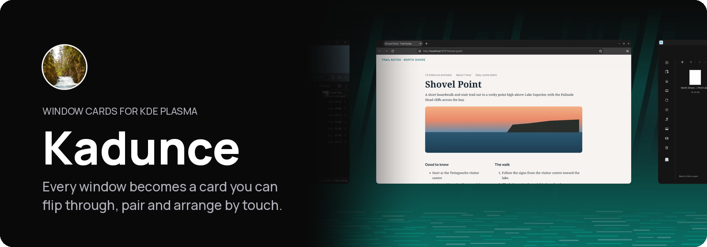

<p align="center">
  <picture>
    <source media="(prefers-color-scheme: dark)" srcset="assets/readme/banner-dark.png">
    
  </picture>
</p>

<p align="center">
  
  
  
  
</p>

<p align="center">
  <a href="#install">Install</a> · <a href="#controls">Controls</a> · <a href="docs/README.md">Docs</a> · <a href="#used-in-shuffle">Used in Shuffle</a>
</p>

<p align="center">
Kadunce turns your windows into cards you can flip through, pair and arrange by
touch, mouse or keyboard. Switch it off and everything goes back to the Plasma
desktop.
</p>


https://github.com/user-attachments/assets/02c3e61f-bb2d-49e1-94b7-08f11d055059


## What you get

<table>
  <tr>
    <td width="33%" valign="top"><b>Cards</b><br>Every application window is a card, and opening an application adds one.</td>
    <td width="33%" valign="top"><b>Spread</b><br>Your cards in one ordered row. The one you choose becomes the Active card, the card you are using.</td>
    <td width="33%" valign="top"><b>Stacks</b><br>Related cards kept together. You step through them one at a time, round and round from the card you opened.</td>
  </tr>
  <tr>
    <td width="33%" valign="top"><b>Bento</b><br>Several cards side by side in one layout. In Spread each pane is its own card, and choosing one brings the layout back.</td>
    <td width="33%" valign="top"><b>Table</b><br>Your workspaces as tabs along the top, each with its cards hanging below. Go to one, or carry a card to another.</td>
    <td width="33%" valign="top"><b>Auto layout</b><br>On a big display, cards lay themselves out side by side. Snap one to an edge to place it, and the rest fill in around it.</td>
  </tr>
</table>

## Controls

| Task | Touch | Keyboard |
| --- | --- | --- |
| Spread | Swipe up from the bottom edge | `Meta+S` |
| Active card | Tap a card in Spread | `Enter` in Spread |
| Bento | Drag a window to the left or right edge | `Meta+B` |
| Table | Pull down from the top edge | `Meta+W` |
| Plasma desktop | Switch Cards off in the tray | `Meta+Esc` |

Kadunce's keys work only while it runs. Every other gesture, tap and key is in
[docs/INPUT.md](docs/INPUT.md).

If anything goes wrong, `Meta+Esc` puts every window back on the Plasma
desktop, and the **Cards** switch in the system tray turns Kadunce off.

## Install

These steps are for Arch Linux or CachyOS running KDE Plasma 6.7 or newer in a
Wayland session, the default on both. Kadunce is built on your computer from
this page's code, so you type a few commands into **Konsole**, Plasma's
terminal. Open it from the application launcher.

### 1. What you need

Check your Plasma version. It must say 6.7 or higher:

```bash
plasmashell --version
```

Bring the computer up to date, then restart it. Kadunce is built against the
KWin that is installed, so the KWin that is running has to be the same one:

```bash
sudo pacman -Syu
```

After the restart, open Konsole again and install what the build needs. Type
your password when asked, and answer `Y`:

```bash
sudo pacman -S --needed base-devel git cmake extra-cmake-modules ripgrep python perl file qt6-base qt6-declarative qt6-tools kwin kdecoration kcoreaddons kconfig ki18n kservice kglobalaccel kstatusnotifieritem libxcb vulkan-headers
```

### 2. Download

This puts the code in a folder called `kadunce` in your home folder. Use
`git` rather than GitHub's Download ZIP, so a later update is one command:

```bash
cd ~
git clone https://github.com/carlsonjm/kadunce.git
cd kadunce
```

### 3. Install

```bash
./install.sh
```

The installer checks the code, builds it and counts its six steps, `[1/6]` to
`[6/6]`, which takes a few minutes. At step 5 a password window asks to put
Kadunce's plugin in place for KWin; type your password there. Don't restart
the computer until it says **All six installation steps completed**.

### 4. Finish

Sign out and back in, so KWin starts with Kadunce loaded.

### 5. Check it worked

- A **Cards** icon is in the system tray. If you don't see it, click the small
  arrow at the tray's end.
- Press `Meta+S`, or swipe up from the bottom edge of a touchscreen. Your open
  windows lay out as cards in a row, Spread. Pick one to use it.
- `Meta+Esc` puts every window back on the Plasma desktop at any time.

### 6. Update

After every system update that brings a new KWin, run the installer again, or
choose **Repair for current KWin…** in the Cards menu. To get a newer Kadunce:

```bash
cd ~/kadunce
git pull
./install.sh
```

If you had Cards switched off, they stay off.

### 7. Turn off or uninstall

To turn Kadunce off without removing it, click the **Cards** switch in the
system tray, or run:

```bash
cd ~/kadunce
./disable.sh
```

Every window goes back to Plasma. The Cards switch turns it on again.

To remove it:

```bash
cd ~/kadunce
./uninstall.sh
```

A password window asks to remove the plugin. Sign out and back in afterwards.
Your settings stay, in `kaduncerc` and in kwinrc's `[Effect-kadunce]`, for a
later install. To delete the download too, run `rm -rf ~/kadunce`. The
packages from step 1 can stay; Plasma uses most of them.

## Displays

Every window is a card, on every display. A small display shows one card at a
time, or a Bento pair. A big display lays its cards side by side, and a card you
pick joins what is already open.

Each display has its own Spread, with its own cards: a card belongs to the
display it stands on, and its display's context line names it. Carry or send a
card to another display and it goes with its Stack, to be shown there. The
primary display, the one you choose, else your touchscreen, else the largest,
takes the cards of a display you unplug.

### Auto layout on a big display

Drag a window to the middle of a side edge and it takes a full-height column
on that side. The bottom quarter of the edge puts it under whatever is already
on that side, and the top quarter puts it on top. A filled box shows where it
will land. With one card open, the next window you open pairs with it. New windows
fill the open room, or join the shortest column, or start a new one, whichever
keeps every window larger. Once the screen is full, Kadunce lays everything out
evenly and keeps your snapped card on its side. If even that cannot fit, the
window you used longest ago steps back into Spread. Drag a divider to fine-tune.

### Prefer your own layout?

If auto layout isn't your thing, keep a display as ordinary windows (below),
draw zones for it with `Meta+T` and switch to them with `Meta+Shift+B`.

<details>
<summary>More about displays</summary>

- A window you carry to another display belongs to that display from then on.
- Unplug the display holding Spread and its cards move to the next one; plug it
  back in and they return. Unplug another display and its cards stay in Spread.
- Search floats on any display, and joins Spread once Spread is open.
- The swipe up to Spread and the pull down to Table work on any display a
  touchscreen drives.
- You can keep other displays as ordinary windows instead, with
  `kaduncerc` `[Spread] OtherDisplays=windows`. There an edge snap arranges
  every window into one Bento layout, or into your zones.

</details>

<details>
<summary>More about cards, Bento and Table</summary>

- A Bento pane's card in Spread sits beside its partners in the layout's order
  until you move it. A window that leaves a layout becomes its own card. Each
  display has one Bento layout at a time.
- Each workspace in Table keeps its own cards and Bento layouts. An empty one
  goes away unless you named it.

</details>

## The Cards menu

Click the **Cards** icon in the system tray to turn Kadunce on or off.

<details>
<summary>What the menu holds</summary>

- **Cards on**, the same switch.
- Which KWin Kadunce was built for, and **Repair for current KWin…**, which
  rebuilds it after a KWin update.
- **Monitors use my zones (Meta+T)**, which switches a display kept as ordinary
  windows between filling itself and your zones, like `Meta+Shift+B`.
- **Settings…**, where you set the gutter around the Active card, 4 to 48 px,
  10 px by default. Bento's panes stand that far apart too.

Every word the menu shows can be translated.

</details>

## For developers

<details>
<summary>Folders and checks</summary>

Read `AGENTS.md` before working in this repository. The documentation index is in `docs/README.md`.

```text
native/                 KWin effect, window controllers, and native tests
control/                system tray control
tests/                  source, package, control, and session checks
docs/                   behavior contracts and architecture
install.sh              verified installation
disable.sh              safe release and temporary disable
uninstall.sh            installed component removal
```

Run the repository checks before proposing a change:

```bash
./verify.sh
```

It runs the documentation, source, package and control checks. `install.sh`
runs the source, package and control checks itself before it builds. Where the
Plasma development stack is missing, `bash tests/verify-headless.sh` is a fast
pre-check: it runs the native domain tests that don't link KWin and needs only
a C++20 compiler and Qt6Core.

Changes to the compositor also need the private route matrix, a fresh login
session and physical testing. `docs/TESTING.md` describes each check and what it
proves.

</details>

## Used in Shuffle

Kadunce needs nothing beyond KDE Plasma. It also works with
[Tettegouche](https://github.com/carlsonjm/tettegouche)'s launcher and
[Gooseberry](https://github.com/carlsonjm/gooseberry)'s notes when they are
installed. [Shuffle](https://shuffleplasma.com), a touch-first desktop for KDE
Plasma, bundles Kadunce with them and with
[Temperance](https://github.com/carlsonjm/temperance) and
[Split Rock](https://github.com/carlsonjm/split-rock), and shows Kadunce as
Cards.

## License

Kadunce is licensed under GPL-2.0-or-later. See `LICENSE`.

The project names and marks are not covered by that licence. See
[TRADEMARKS.md](TRADEMARKS.md).

<p align="center"><picture><source media="(prefers-color-scheme: dark)" srcset="assets/readme/good-input-white.png"></picture></p>
